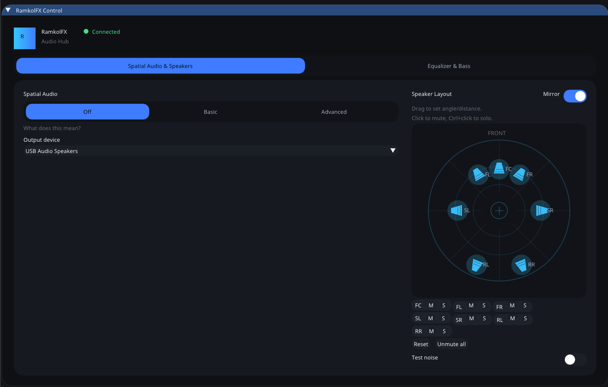
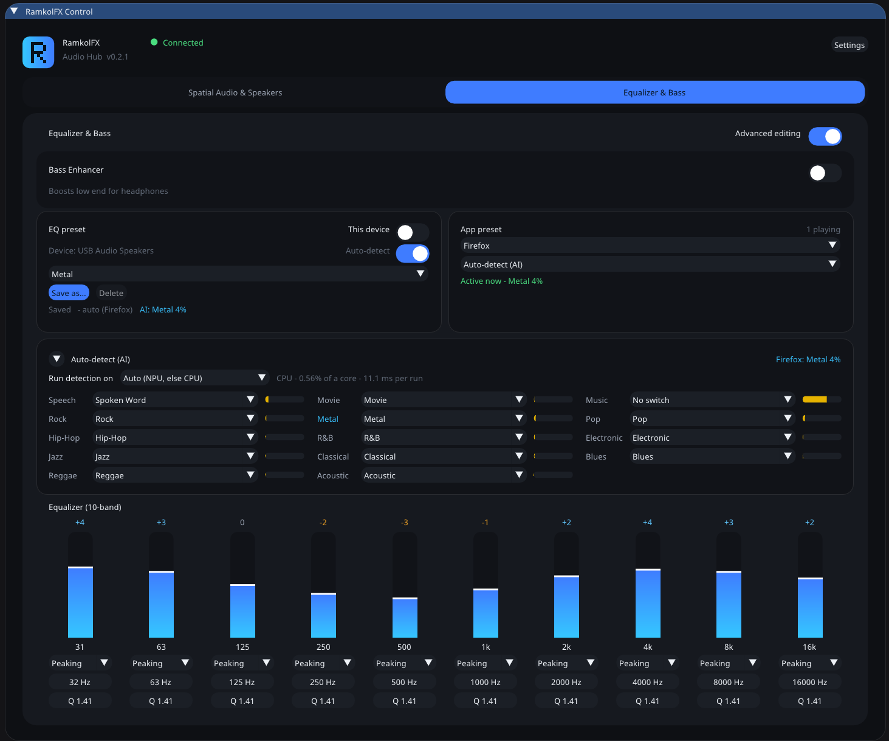

# RamkolFX

A Linux audio DSP daemon that provides ambisonics-style 7.1-to-stereo
spatialization for headphones. Unlike typical "virtual surround" plugins
that apply a fixed per-channel HRTF, RamkolFX encodes the 7.1 signal into
an ambisonics sound field and decodes that field to stereo, so positioning
stays accurate as speakers move and the mix doesn't collapse into six
separately-panned point sources.

## Table of contents

- [Screenshots](#screenshots)
- [Download](#download)
- [Install & Run](#install--run)
- [Versioning](#versioning)
- [Status](#status)
- [Architecture](#architecture)
- [Directory layout](#directory-layout)
- [Control protocol](#control-protocol)
- [Adding your own SOFA files](#adding-your-own-sofa-files)
- [Engineering approach](#engineering-approach)
- [Roadmap](#roadmap)
- [License](#license)

## Screenshots

> **Note:** the GUI is a convenience for exercising the daemon during
> development, not a design target right now. Functionality — the DSP
> pipeline, control protocol, and daemon behavior — is the priority; GUI
> polish is out of scope until that's solid.

| Spatial Audio & Speakers | Equalizer & Bass |
| --- | --- |
|  |  |

## Download

Prebuilt packages are attached to every [GitHub release](https://github.com/Coldsteel48/RamkolFX/releases/latest)
(x86_64). Each one installs `ramkolfxd`, `ramkolfx-gui`, the bundled HRTFs,
a desktop entry and a systemd *user* unit.

| Distro | Package | Install |
| --- | --- | --- |
| Debian / Ubuntu | [`.deb`](https://github.com/Coldsteel48/RamkolFX/releases/latest) | `sudo apt install ./ramkolfx_*_amd64.deb` |
| Fedora / RHEL / openSUSE | [`.rpm`](https://github.com/Coldsteel48/RamkolFX/releases/latest) | `sudo dnf install ./ramkolfx-*.rpm` |
| Arch / CachyOS / Manjaro | [`.pkg.tar.zst`](https://github.com/Coldsteel48/RamkolFX/releases/latest) | `sudo pacman -U ramkolfx-*.pkg.tar.zst` |
| Alpine | [`.apk`](https://github.com/Coldsteel48/RamkolFX/releases/latest) | `sudo apk add --allow-untrusted ./ramkolfx-*.apk` (or add the release's `ramkolfx-alpine-key.rsa.pub` to `/etc/apk/keys/`) |
| Gentoo | [`.ebuild`](packaging/gentoo/media-sound/ramkolfx) | copy into a local overlay as `media-sound/ramkolfx/`, then `ebuild ramkolfx-*.ebuild manifest` and `emerge media-sound/ramkolfx` |
| Nix | [`flake.nix`](flake.nix) | `nix run github:Coldsteel48/RamkolFX` (GUI) or `nix profile install github:Coldsteel48/RamkolFX` |

Requires PipeWire >= 1.4 (Debian 13+, Ubuntu 25.04+, Fedora 42+, Alpine 3.22+,
current Arch). Then start the daemon (it needs a running PipeWire session):

```sh
systemctl --user enable --now ramkolfxd
ramkolfx-gui
```

The recipes live in [`packaging/`](packaging) and are built by
[`.github/workflows/packages.yml`](.github/workflows/packages.yml) whenever a
`v*` tag is pushed.

## Install & Run

**Dependencies** — daemon: CMake >= 3.20, a C++20 compiler, Ninja,
`pkg-config`, PipeWire dev headers (`libpipewire-0.3`), zlib dev headers,
pthreads. GUI (optional, `-DRAMKOLFX_BUILD_GUI=ON`): SDL2 >= 2.0.18 dev headers,
OpenGL dev headers/libs, fontconfig, libdbus-1 and libX11 dev headers. Network access is needed on first configure —
CMake `FetchContent` pulls libmysofa + KissFFT (daemon) and Dear ImGui
(GUI), none of which are common distro packages.

On a fresh machine, run `./FetchDependencies.sh` to install the right
packages for your distro (Debian/Ubuntu, Fedora, Arch, openSUSE detected
via `/etc/os-release`; `--no-gui` skips GUI-only packages, `--dry-run`
just prints the command).

```sh
cmake -S . -B build -G Ninja -DRAMKOLFX_BUILD_GUI=ON
cmake --build build
# or just:
./build.sh          # ./build.sh clean wipes build/ first
./build.sh test     # build, then run the unit tests (ctest --test-dir build)
tests/e2e/run.sh    # end-to-end tests against live PipeWire (daemon must not be running)
```

Binaries land at `build/daemon/ramkolfxd` and `build/gui/ramkolfx-gui`.

```sh
./run.sh             # starts the daemon, then the GUI; Ctrl+C stops both
./run.sh daemon       # daemon only (foreground)
./run.sh gui          # GUI only, against an already-running daemon
```

Starting the daemon creates the "RamkolFX Virtual Sink" in the PipeWire
graph, claims it as the system default output (so most apps route to it
automatically), and plays the processed result out through a real
hardware sink — auto-picked on first run and remembered thereafter
(`settings.conf`), or chosen live via `SetOutputDevice` / the GUI's device
picker. To route only a specific app instead of changing the system
default, use `pavucontrol`, `wpctl`, or
`pw-play --target ramkolfx_virtual_sink some_7.1_file.wav`. The daemon's
own output stream is pinned to the real sink it's configured with, so
claiming the virtual sink as default can't feed back into itself.

State lives in `$XDG_CONFIG_HOME/ramkolfx` (default `~/.config/ramkolfx`):
`settings.conf` (spatial mode per device, speaker layout, EQ curve, output
device, HRTF choice), `presets.conf` (your EQ presets and their device/app
bindings), `gui_prefs.conf` (GUI-only display and tray choices), and `hrtf/` for
your own SOFA files. All are plain `key=value` text.

The GUI's **Settings** button (top right) holds the window behavior options:
start at login (writes `~/.config/autostart/ramkolfx.desktop`, which launches
`ramkolfx-gui --minimized`), and minimize to the system tray on close and/or
on minimize. The tray icon uses the freedesktop StatusNotifierItem protocol,
so it shows on KDE Plasma, COSMIC, Xfce, waybar etc., and on GNOME with the
AppIndicator extension; with no tray host around, close and minimize just
behave normally. Native Wayland sessions never tell an app it was minimized,
so minimize-to-tray only works on X11 — on Wayland use close-to-tray. Only one
GUI runs at a time: launching it again brings up the existing window.

## Status

Pipeline runs end-to-end with three selectable spatialization paths,
switched live via the `SetSpatialMode` control command (`SpatialMode`:
`Off` / `Basic` / `Advanced`), all sharing one live-repositionable
`SpeakerLayout` behind a common `DspStage` interface. The mode is
remembered per output device (e.g. Advanced on headphones, Off on
speakers) and restored whenever that device is selected:

- **Off** — static-gain downmix (`PassthroughStage`).
- **Basic** — `AmbisonicsStage` encodes the 7 non-LFE 7.1 channels as
  point sources into a shared first-order B-format sound field, then
  decodes algebraically (non-HRTF) to two virtual stereo speakers. An
  improvement over static downmix, but a linear 2-speaker decode can't
  fully preserve front/back distinction.
- **Advanced** — `BinauralStage` decodes the same B-format field to a
  fixed 8-point virtual loudspeaker array and convolves each speaker's
  signal with an HRIR for that direction (KissFFT partitioned
  overlap-save convolver), summing to stereo. The HRIR source is either
  measured SOFA data (via libmysofa) or a procedural rigid-sphere model
  (`synthetic_hrtf.cpp`); a failed SOFA load falls back to Basic's
  algebraic decode rather than going silent. Since HRTF perception is
  ear-shape-specific, `HrtfDeck` wraps two `BinauralStage`s so the active
  source can be switched live from the GUI's HRTF dropdown (or
  `SetHrtfFile`) with a ~50ms crossfade and no restart. The bundled
  catalog (`GetHrtfCatalog`, see `data/hrtf/README.md`) — MIT KEMAR
  (default), full SADIE II (20 entries), 5 HUTUBS subjects, 5 SONICOM
  subjects, and the synthetic model — is all permissively licensed and
  safe to redistribute commercially, unlike CIPIC/ARI/Listen/RWTH Aachen,
  which were avoided for that reason. The daemon also watches a
  user-writable directory (`$XDG_CONFIG_HOME/ramkolfx/hrtf` by default,
  plus `RAMKOLFX_HRTF_DIR` if set) and live-appends any `.sofa` files
  found there, prefixed `(user) `, via inotify — see
  ["Adding your own SOFA files"](#adding-your-own-sofa-files) below.

Downstream of the spatial stage: a 10-band graphic EQ (`HwEqStage`) and a
psychoacoustic bass enhancer (`BassEnhancerStage`), both live-adjustable
per-band from the GUI's "Equalizer & Bass" tab (`SetHwEqBand` /
`SetBassEnhancer`). The EQ curve plus bass enhancer can be saved as named
presets (built-ins: Flat, Bass Boost, Vocal) and bound to an output
device or to an app: the daemon tracks which apps are playing into the
virtual sink and auto-switches to the bound preset, restoring the
previous sound when they stop - see
[docs/eq-presets-plan.md](docs/eq-presets-plan.md) for the exact rules.
Genre auto-detect is still a disabled placeholder.

Virtual speaker positions are live-repositionable both at the API level
(`SetSpeakerAzimuth`/`GetSpeakerAzimuth`, lock-free) and over the control
protocol, with the GUI's speaker dial driving this in whichever mode is
active.

## Architecture

```
   client app (game, media player)
            │  renders 7.1 via OpenAL / PipeWire
            ▼
   PipeWire virtual sink  ("RamkolFX Virtual Sink")
            │  captured by the daemon
            ▼
   DSP stage  (PassthroughStage / AmbisonicsStage / BinauralStage,
               selected live by SpatialMode)
            │  stereo
            ▼
   10-band EQ  →  bass enhancer  (HwEqStage, BassEnhancerStage; curve
            │                     switched by named presets / bindings)
            ▼
   real hardware output  (via a PipeWire playback stream)

   GUI control app  <──Unix socket, binary protocol──>  daemon
```

- **`ramkolfxd`** (the daemon) owns the real audio output device. Client
  apps render into a PipeWire virtual sink instead of talking to hardware
  directly, exactly as if it were a normal output device.
- The daemon captures from that virtual sink, runs it through whichever
  DSP stage `SpatialMode` selects, and plays the result out through a
  second PipeWire stream pinned to a specific real hardware sink.
- The daemon also tracks which apps are playing into the virtual sink, so
  it can switch the EQ to a preset bound to the playing app or to the
  current output device.
- The **GUI control app** (`ramkolfx-gui`, Dear ImGui + SDL2/OpenGL3)
  talks to the daemon over the Unix socket to switch spatial mode,
  reposition virtual speakers, adjust EQ/bass live, and manage EQ presets
  and their device/app bindings, across two tabs ("Spatial Audio &
  Speakers" and "Equalizer & Bass").

For a per-class map of the code, see [docs/classes.md](docs/classes.md).

## Directory layout

- `common/` — shared code between daemon and GUI: control protocol + a
  lock-free ring buffer. No PipeWire dependency.
- `daemon/` — `ramkolfxd`: PipeWire pipeline, DSP stages, control socket
  server.
- `gui/` — `ramkolfx-gui`: Dear ImGui + SDL2/OpenGL3 control app (build
  with `-DRAMKOLFX_BUILD_GUI=ON`). Talks to the daemon only over the Unix
  control socket — no PipeWire dependency.
- `tests/` — unit tests (CTest, `./build.sh test`) for the protocol,
  preset store, auto-switching and settings persistence; `tests/e2e/` holds
  the end-to-end tests that drive a real daemon on a live PipeWire session.
- `docs/` — design notes ([EQ presets](docs/eq-presets-plan.md),
  [near-field distance](docs/near-field-distance-plan.md)), the
  [per-class overview](docs/classes.md), and screenshots.

## Control protocol

The daemon and any control client speak a small hand-rolled **binary**
protocol over a Unix domain socket — not JSON — to keep the control path
cheap enough to poll frequently (e.g. for live speaker repositioning). See
`common/include/ramkolfx/protocol.hpp` for the wire format and rationale;
it's isolated to that header/.cpp pair so it can change without touching
daemon or GUI logic built on top of it.

Socket path: `$XDG_RUNTIME_DIR/ramkolfx/control.sock` (falls back to
`/tmp/ramkolfx-<uid>/control.sock`).

## Adding your own SOFA files

Beyond the bundled catalog (MIT KEMAR + full SADIE II (20) + HUTUBS (5) +
SONICOM (5) + the synthetic model — see `data/hrtf/README.md`), you can
add your own HRTF measurements (CIPIC, ARI, Listen, or your own) without
rebuilding:

1. Drop the `.sofa` file into `$XDG_CONFIG_HOME/ramkolfx/hrtf` (falls back
   to `~/.config/ramkolfx/hrtf`, created automatically). Set
   `RAMKOLFX_HRTF_DIR` if you'd rather use an additional directory of your
   own choosing — it's watched alongside the default, not instead of it.
2. That's it — the daemon watches both directories via inotify and adds
   files to the catalog live, prefixed `(user) `, no restart needed.
   They'll show up in the GUI's HRTF dropdown (or via `SetHrtfFile`)
   alongside the bundled entries.

Matching is purely by `.sofa` extension; files aren't parsed until
selected, so a corrupt or non-SOFA file just fails gracefully back to
silence for that entry. RamkolFX doesn't vet or redistribute anything
placed here, so it's the right place for datasets whose license doesn't
allow redistribution. See `data/hrtf/README.md` for the full details and
for `RAMKOLFX_HRTF_SOFA`, a lower-level env var override for a one-off
file outside the catalog entirely.

## Engineering approach

The ambisonics math and daemon/GUI control logic are being written from
scratch — that's the core IP. It's fine to bootstrap with permissively
(BSD-style) licensed third-party libraries (libmysofa, KissFFT) once real
DSP work starts, but they sit behind clean, swappable interfaces (see
`daemon/src/dsp/dsp_stage.hpp`) so they can be replaced later without
touching the rest of the pipeline.

## Roadmap

1. ~~Working local pipeline: virtual sink → capture → placeholder DSP → real output~~
2. ~~One-click 3D on/off toggle: wired end-to-end and now audibly meaningful (PassthroughStage vs AmbisonicsStage)~~
3. ~~Real-time repositionable virtual speakers: control-protocol opcode + GUI dial~~
4. ~~HRTF-based binaural decode (libmysofa + KissFFT), selectable as the "Advanced" `SpatialMode` alongside algebraic ambisonics~~
5. ~~Switchable HRTF catalog (MIT KEMAR + full SADIE II/HUTUBS/SONICOM databases + a license-free synthetic spherical-head model) with live, crossfaded switching via `HrtfDeck` and the GUI's HRTF dropdown~~
6. ~~Parametric EQ: 10-band graphic EQ + psychoacoustic bass enhancer, both live-adjustable from the GUI's Equalizer & Bass tab~~
7. ~~Named EQ presets with per-device and per-app auto-switching~~
8. ONNX-based automatic EQ preset selection / genre auto-detect (also a
   disabled placeholder in the GUI today)
9. GUI polish aimed at non-audio-engineer users — two-tab layout
   (Spatial Audio & Speakers / Equalizer & Bass) and the preset cards have
   landed; ongoing refinement

## Versioning

RamkolFX follows [Semantic Versioning](https://semver.org/). The current
version lives in the [`VERSION`](VERSION) file. It is pre-1.0: expect rough
edges, and until then anything (control protocol, settings/preset formats,
CLI) may change between releases. Pre-releases are tagged
`vMAJOR.MINOR.PATCH-alpha.N`, then `-beta.N`, `-rc.N`, then the plain
release; GitHub marks every one of those except the last as a pre-release.

`ramkolfxd --version` / `ramkolfx-gui --version` print the version, and the
GUI shows it under its logo. Changes are listed in [CHANGELOG.md](CHANGELOG.md).

**Cutting a release** (the only manual step is editing `VERSION`):

```sh
echo 0.2.0-alpha.1 > VERSION     # must be newer than the latest tag
packaging/version.sh sync        # rewrites every distro recipe + flake.nix
# add a "## [0.2.0-alpha.1]" section + link to CHANGELOG.md, commit
packaging/version.sh check       # catches the mistakes below before you tag
git tag v0.2.0-alpha.1 && git push origin master v0.2.0-alpha.1
```

CI refuses to build if the tag, `VERSION` and the recipes disagree, if
`VERSION` is not newer than every earlier release tag, or if CHANGELOG.md
has no section for `VERSION` or links to a tag that doesn't exist
(`packaging/version.sh check <tag>`), then builds all packages and publishes
the release. Distros spell pre-releases differently (`0.1.0~alpha.1` on
Debian, `0.1.0_alpha1` on Arch/Alpine/Gentoo, `Release: 0.1.alpha1` on RPM);
`version.sh` handles the conversion and `version.sh show` prints each one.

## License

RamkolFX is dual-licensed: freely under the GNU General Public License
v3.0 (see [LICENSE](LICENSE)), or under a separate commercial license for
proprietary/closed-source use (see [LICENSE-COMMERCIAL.md](LICENSE-COMMERCIAL.md)).
Contributions are accepted only under the terms of the Contributor License
Agreement (see [CLA.md](CLA.md)), which is what makes offering both tracks
possible.
